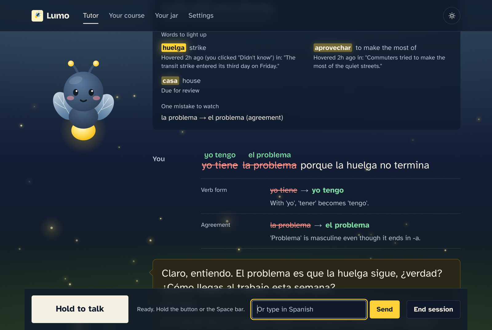
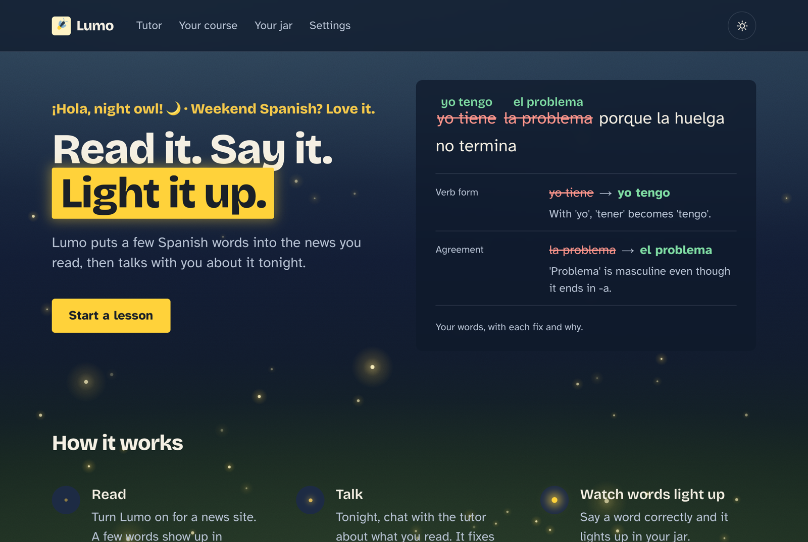
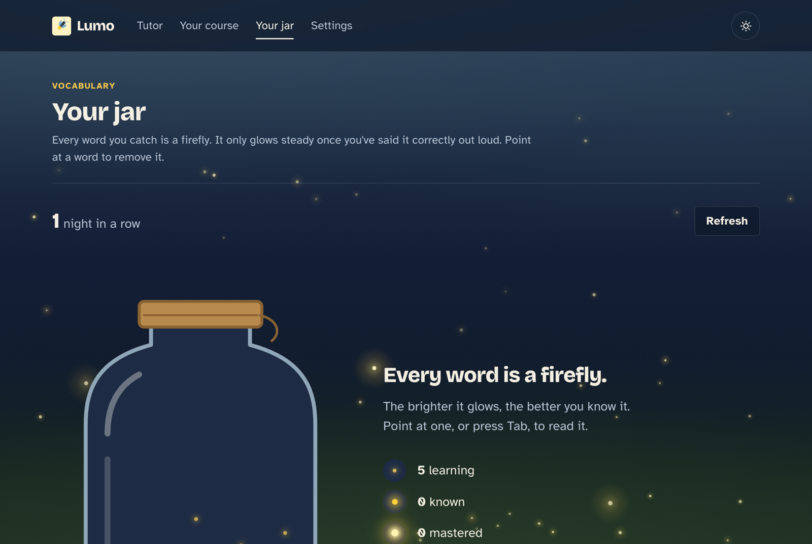
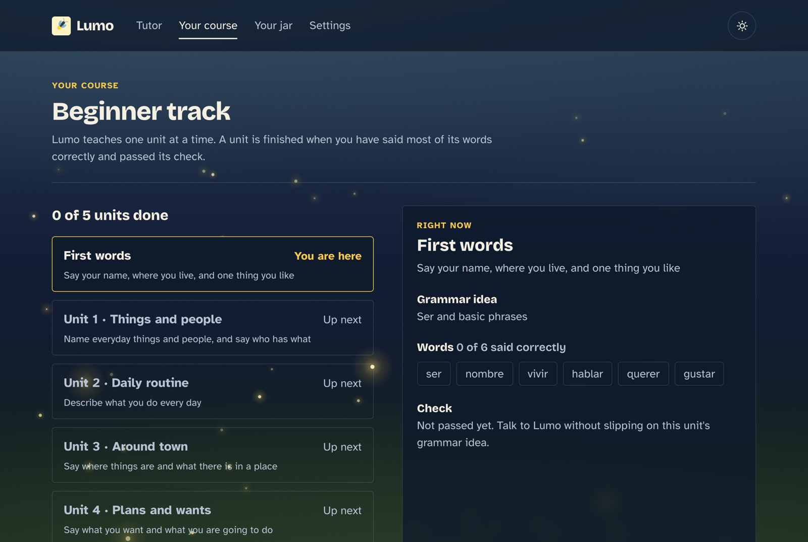
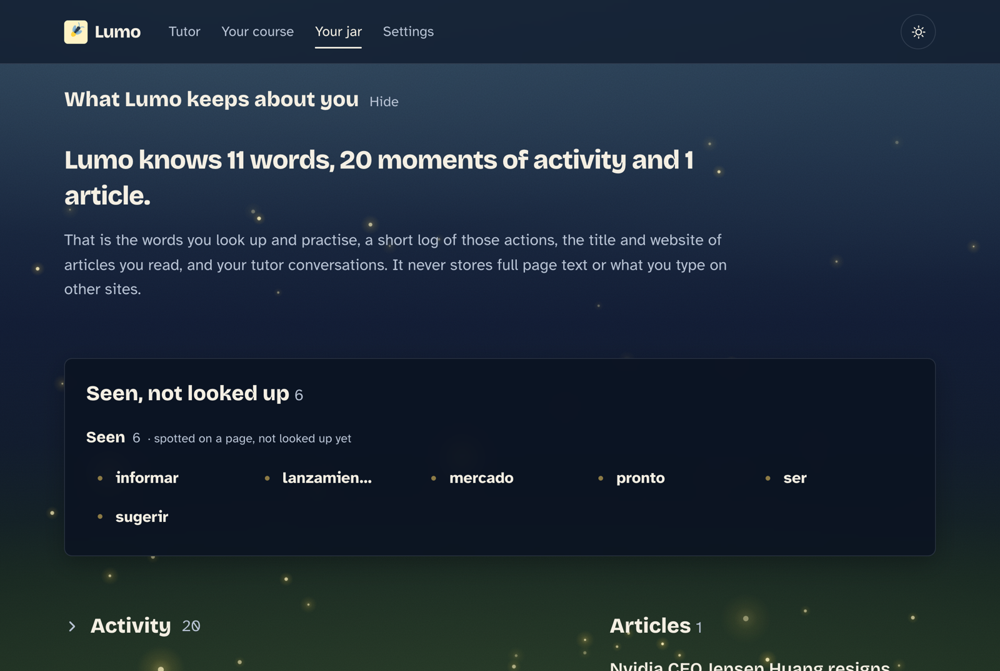
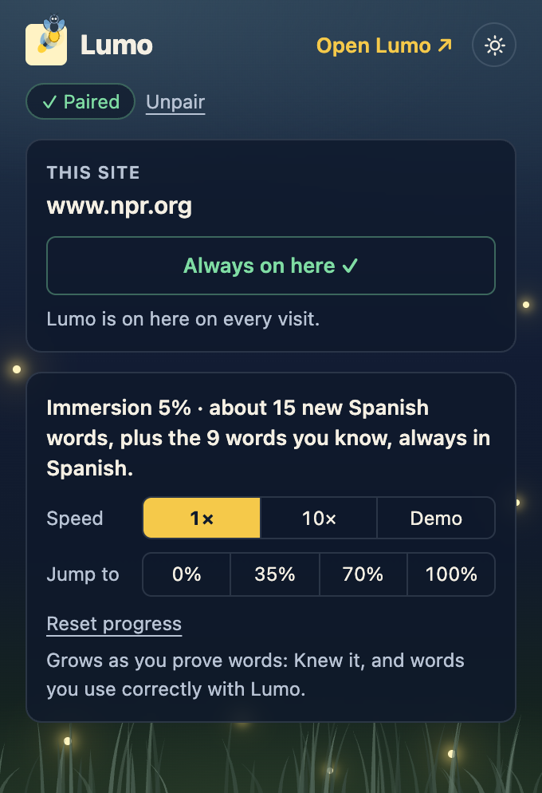

# Lumo

**Your morning reading becomes tonight's conversation lesson.**

Lumo swaps a few English words into Spanish on the sites you already read. In the evening, a voice tutor chats with
you about that article and corrects your mistakes as you talk. A word only counts as learned once you've used it
correctly out loud.

**Watch the demo here**
[](https://www.youtube.com/watch?v=n8UM26dbQ30)

*Built at HackPrinceton Fall 2026 · Amazon track: Best Practical AI Innovation.*

---

## What it does

1. **Read.** Turn the Chrome extension on for a site you like (NPR, Wikipedia, a recipe blog). A few English words
   become Spanish (*the strike → la huelga*). Hover or click one to see its meaning, hear it, and mark *Knew it* or
   *Didn't know*.
2. **Talk.** Open the tutor. Lumo opens with the article you read and steers the chat toward the words you looked up.
   Hold Space (or type) and answer in Spanish. Mistakes appear in your own sentence, struck through, with the fix and a
   one-line English reason, while Lumo keeps the conversation going.
3. **Light up.** A word counts as learned only when you use it correctly out loud. Then it glows steady in your jar.
   Hovering a word is never enough.

**Who it's for:** learners of Latin American Spanish, from complete beginners to upper-intermediate, who read English
online every day but don't have a fluent speaker to practise with. The interface and explanations are in English.

## Screenshots

| | |
|---|---|
|  **Home.** One promise, one example correction, three steps. |  **Your jar.** Every word is a firefly: *still faint* while you learn it, *glowing steady* once you've said it right, *shining bright* once it sticks. |
|  **Your course.** One unit at a time, each with a can-do goal, a grammar idea and its words. |  **What Lumo keeps about you.** Everything stored, with a delete button on each item and "Delete everything". |

<p align="center"></p>
<p align="center"><b>Extension popup.</b> Turn Lumo on for the current site, set the immersion level, or pair with the web app.</p>

<!-- TODO(shravan): hover-card screenshot. Take it on the NPR demo article: click a Spanish word so the card shows
     "la huelga · strike", the speaker button and Knew it / Didn't know. Save as docs/img/hover-card.png and add it here. -->

The tutor screenshot is from **rehearsal mode** (`/tutor?mock=1`), which plays a scripted sample conversation with the
same screens and no microphone or API calls.

## How it works

```
Chrome extension (MV3)                      Web app (Next.js)
  swaps words on sites you turn on            Tutor · Your course · Your jar · Settings
  hover cards, look-up events                 push to talk / hands-free, live corrections, recap
        │  (pairing token)                               │
        ▼                                                ▼
     Next.js API routes  ─────────────────────►  Supabase (Postgres)
     learner model · FSRS review schedule · ~3,000-word Spanish list · course units
        │                                │
        ▼                                ▼
  Claude (Anthropic)                ElevenLabs
  Haiku 5.5: corrections            Scribe v2 realtime: speech-to-text
  Sonnet 5.5: the conversation      Flash v2.5: Lumo's voice
```

- **Two models in parallel.** When you stop talking, Claude Haiku checks your sentence and Claude Sonnet writes the
  reply at the same time, so the correction is on screen while Lumo is still speaking. The reply is streamed and sent to
  text-to-speech one sentence at a time, so the voice starts before the whole reply is written.
- **Honest grading.** Only the raw speech-to-text transcript is graded, never a cleaned-up version. A flagged mistake
  must appear word for word in what you said, only corrections with confidence ≥ 0.7 are shown, and accents and
  punctuation are never graded when you speak (speech-to-text adds those itself).
- **The tutor decides how to teach, and shows why.** It plans the lesson from your data (the article you read, words you
  hovered, words due for review) and shows that plan as a *Tonight's lesson* card. A first mistake is only shown on
  screen while Lumo says the right form back to you; it corrects out loud only when a mistake repeats. A small grey
  "why" line under each reply says what it chose, e.g. *"Not correcting out loud yet: Lumo waits until a mistake comes
  up in two turns"*.
- **It adapts to you.** Each word moves through evidence levels: seen → learning → known → mastered. Hovering can move a
  word to *learning*; only using it correctly in speech makes it *known* (*Knew it* counts as a good review, but never
  marks a word known by itself). Reviews follow **spaced repetition**
  (FSRS, via `ts-fsrs`), so words you keep forgetting come back sooner. The extension swaps more words as you prove
  more, and the course moves to the next unit when you've said most of its words and passed its grammar check.
- **Fails gracefully.** If the database is down, the tutor runs a default lesson. If the voice fails twice, the browser's
  voice reads the replies. If a correction can't be checked, the screen says so instead of claiming "no mistakes".

More detail: [`docs/architecture.md`](docs/architecture.md), [`docs/voice-plan.md`](docs/voice-plan.md) and the decision
log in [`docs/decisions.md`](docs/decisions.md).

### How well it works

Measured on 50 Spanish sentences (35 with one planted learner mistake, 15 correct), through the same endpoint the
tutor uses. Full method and per-mistake results: [`eval/README.md`](eval/README.md).

| | Result |
|---|---|
| Flags that were real mistakes (precision) | **100%** (32/32) |
| Planted mistakes caught (recall) | **91%** (32/35) |
| False alarms on correct sentences | **0%** (0/15) |
| Correction time on the server, median / p90 | **1.05 s** / 1.32 s |
| Correction on screen after you stop talking, median (laptop, wifi / phone hotspot) | **1.35 s** / 1.49 s |
| Lumo starts speaking after you stop talking, median (wifi / hotspot) | **1.58 s** / 2.20 s |

Speech-to-text kept 80% of the planted mistakes when a teammate read the sentences, and never "fixed" one.

## Privacy

- **Off until you turn it on.** The extension has no access to any site until you switch it on for that site, and
  Chrome asks you to confirm.
- **A hard never-list.** Lumo never runs on email, chat, banking, health, school and work tools (Google Docs, Canvas,
  GitHub and similar), or login and form pages, even if you turn it on there. This is checked in the extension and
  on the server.
- **Minimal data.** It never sends full page text, your browsing history, or anything you type on other sites. It
  stores the words you look up, a short activity log, article titles and websites, and your tutor conversations.
- **See and delete everything.** "What Lumo keeps about you" (at the bottom of Your jar) lists every stored item with a
  delete button, plus "Delete everything".
- **No keys in the browser.** Every Claude and ElevenLabs call goes through a server route; speech-to-text connects
  with a single-use token.

## Run it locally

**You need:** Node 24 or newer (set in `package.json` `engines`; there's no `.nvmrc`), Chrome, a Supabase project,
an Anthropic API key and an ElevenLabs API key.

1. **Install** (once, at the repo root):
   ```bash
   npm install
   ```
2. **Configure.** Copy the example env file and fill in your own values. Never commit `web/.env.local`.
   ```bash
   cp .env.example web/.env.local
   ```
   | Variable | What it is |
   |---|---|
   | `ANTHROPIC_API_KEY` | Claude API key (server only) |
   | `ELEVENLABS_API_KEY`, `ELEVENLABS_VOICE_ID` | Speech-to-text and Lumo's voice (server only) |
   | `SUPABASE_URL`, `SUPABASE_SERVICE_KEY` | Your Supabase project (server only) |
   | `DEMO_USER_ID` | The single demo account's id (any UUID) |
   | `NEXT_PUBLIC_API_BASE` | The web app's address, e.g. `http://localhost:3000` |
3. **Set up the database.** Paste [`web/db/schema.sql`](web/db/schema.sql) into the Supabase SQL editor and run it, then
   load the word list and a demo account:
   ```bash
   npm run seed-words -w scripts   # the ~3,000-word Spanish list
   npm run demo:returning          # a demo learner with some history (or: npm run demo:new for a fresh start)
   ```
4. **Start the web app:**
   ```bash
   npm run dev:web                 # http://localhost:3000
   ```
   Without keys, the pages and stub API routes still work with sample data, and `/tutor?mock=1` plays the rehearsal
   conversation. If every outside call fails with `fetch failed` on a Homebrew Node install, start it with
   `NODE_OPTIONS=--use-bundled-ca npm run dev:web`.
5. **Build and load the extension:**
   ```bash
   npm run build:ext
   ```
   In Chrome, open `chrome://extensions`, turn on **Developer mode**, click **Load unpacked** and choose
   `extension/dist`. After any rebuild, click the reload icon on the Lumo card. The extension talks to
   `http://localhost:3000`.
6. **Pair.** Go through setup at `http://localhost:3000/onboarding` (or open Settings). It shows a 6-digit pairing code
   (valid for 15 minutes). Open the Lumo popup, enter the code and click **Pair**. Pairing also turns on the reading sites
   you picked during setup, with one Chrome prompt.
7. **Turn it on for a site.** On a page you want to read, open the popup and click **Try on this page** (this visit only,
   no prompt) or **Always on for this site** (Chrome asks once). A few Spanish words appear on the page.

## Tech stack

- **Web app and API:** Next.js 16 (App Router), React 19, TypeScript, Tailwind CSS v4
- **Database:** Supabase (Postgres)
- **AI:** Claude Haiku 5.5 (corrections, word list) and Claude Sonnet 5.5 (conversation), via the Anthropic SDK with
  structured outputs
- **Voice:** ElevenLabs Scribe v2 realtime (speech-to-text) and Flash v2.5 (text-to-speech)
- **Learning:** `ts-fsrs` (spaced repetition)
- **Extension:** Chrome Manifest V3, bundled with esbuild
- **Shared contracts:** zod schemas in `/shared`, used by the web app and the extension

## Team

<!-- TODO(shravan): confirm each line with the team before submitting. -->
- **Andrew:** the project scaffold and shared contracts, and the voice tutor (speech-to-text, corrections, replies,
  voice, lesson plan, recap), the onboarding level check and the immersion system; integration.
- **Karthik:** the data and learner model (word list, database, spaced repetition, APIs), the course, hands-free mode,
  the demo seed and the accuracy evaluation.
- **Naren:** the Chrome extension (word swaps, hover cards, events, pairing, *Try on this page*, recommended-site dot),
  the evaluation sentence sets and the demo script.
- **Shravan:** the web app's interface and design (the Lumo look and mascot, tutor page, jar, course and setup screens,
  light/dark mode), the extension popup's look, and this README.

## Known limitations

- **One demo account, no login.** Everything runs as a single user, and the extension is hard-wired to `localhost:3000`;
  there's no hosted version.
- **Tested on a few sites.** Swaps are tuned for NPR and checked on a handful of reading sites. Other layouts may show
  swaps imperfectly.
- **Speed on slow networks.** Typical turns meet the targets (correction ≤ 1.5 s, voice ≤ 2 s), but the slowest 10% of
  turns are over, and on a phone hotspot the voice starts in about 2.2 s.
- **The checker isn't perfect.** It catches about 9 in 10 planted mistakes and still misses some (for example *ser* vs
  *estar* for events). Speech-to-text occasionally fixes a mistake before Lumo hears it.
- **Spanish only**, Latin American, with an English interface.
- **Not built yet:** the false-friend fun fact on the hover card, and the snooze / schedule / peek controls and in-page
  quiz from the original plan. Hands-free mode (talk without holding a key) was added at the end of the hackathon
  and has had the least testing.
- **What's next:** accounts and a hosted server, the in-page quiz, more languages, and a phone version of the tutor.

## Credits and licenses

- **Word frequencies:** [FrequencyWords](https://github.com/hermitdave/FrequencyWords) by Hermit Dave, derived from
  [OpenSubtitles 2018](http://www.opensubtitles.org/), licensed
  [CC-BY-SA 4.0](https://creativecommons.org/licenses/by-sa/4.0/). Our derived word list is shared under the same
  licence. Method: [`scripts/README.md`](scripts/README.md).
- **Fonts:** Atkinson Hyperlegible, Bricolage Grotesque and IBM Plex Mono, via Google Fonts, under the SIL Open Font
  License.
- **Artwork:** the firefly mascot, night sky, grass and jar are drawn in code by the team. No third-party images are used.
- **Services:** Claude (Anthropic) for corrections and conversation; ElevenLabs for speech-to-text and voice.
- **Open-source libraries:** Next.js, React, Tailwind CSS, Supabase JS, the Anthropic SDK, `ts-fsrs`, zod and esbuild,
  under their own (MIT-style) licenses.

---

Built at HackPrinceton Fall 2026.
