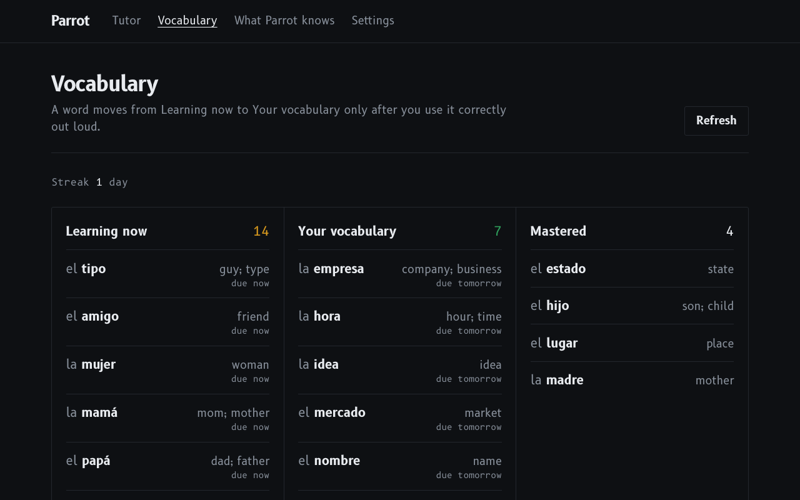
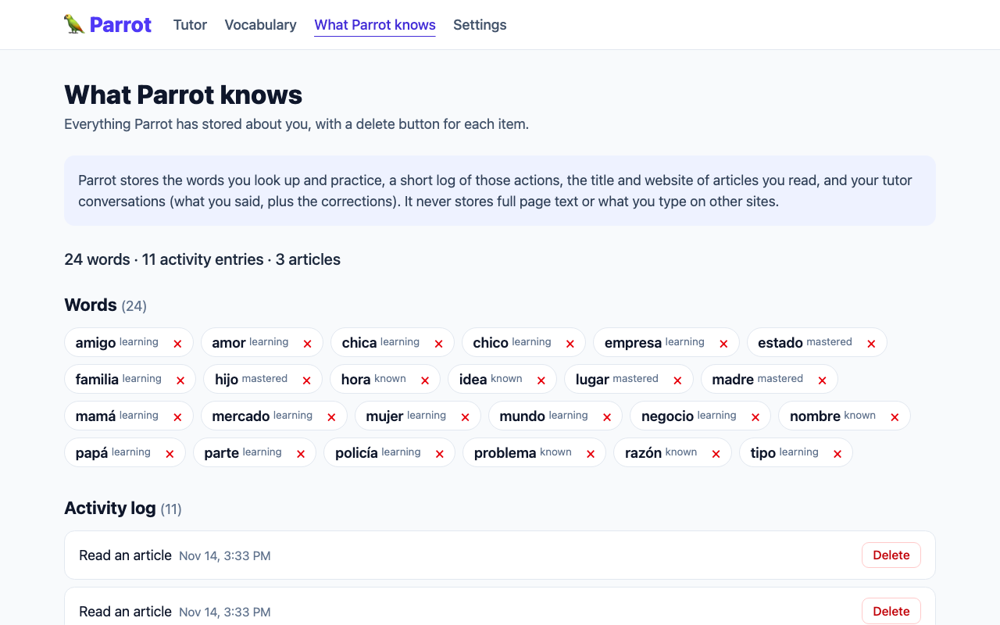

# Luci

> **Your morning reading becomes tonight's conversation lesson.**
> Luci swaps a few English words into Spanish on sites you choose, learns which ones you don't know yet,
> and then a voice tutor chats with you about what you read, correcting you instantly like a fluent friend.
> A word only counts as learned once you use it correctly out loud.

Built for HackPrinceton Fall 2026 · Amazon track: Best Practical AI Innovation.
The name comes from *luciérnaga* (firefly): every word you learn glows a little brighter. (Parrot was the working name, and the code still uses it.)

<!-- TODO(demo): hero screenshot of the tutor page (docs/img/tutor.png) -->

## Who it's for and the problem
**For:** intermediate learners of (Latin American) Spanish, such as college students and young professionals, who already read
English news every day but never find time to study.

**The problem:** the two kinds of tools people use don't talk to each other.
- **Browse-to-learn extensions** (Toucan and similar) swap words while you read, but stop at vocabulary. You never practise speaking.
- **AI speaking tutors** (Speak, Praktika and similar) let you talk, but they don't know what you've been reading, so the
  conversation is generic and nothing you read gets practised.

## Usefulness
- **Speaking practice without a fluent speaker nearby.** Most learners never get conversation practice; Luci gives it
  every evening, about what you actually read.
- **No new habit needed.** It works inside reading you already do, so the vocabulary comes from your own news, not a
  textbook list.
- **Corrections you can trust.** On our test set it flagged no correct sentence (0% false alarms) and every flag was a
  real mistake (100% precision). A tutor that corrects things you said right teaches you to ignore it.
- **English support that fits your level.** Beginners get English help built into what the tutor says; upper-intermediate
  learners get Spanish only. Every correction comes with a one-line English reason.

## Creativity: what's different
Luci connects reading and speaking in one loop:
1. **Read:** on a news site you've enabled, a few English words become Spanish (*the strike → la huelga*). Hover or click one
   for the meaning and pronunciation. Luci notes which words you looked up.
2. **Talk:** a *Tonight's lesson* card shows what the tutor planned from your reading: the article, the words it will
   steer toward and why, and one mistake to watch. The tutor opens with that article. You hold Space and answer in Spanish.
3. **Get corrected, instantly:** your words appear on screen with mistakes struck through, the fix in green, and a
   one-line English reason. The tutor keeps talking; it doesn't stop to lecture you.
4. **Prove it:** use a target word correctly out loud and it lights up in your jar, from *Still faint* to *Glowing steady*.
   Seeing or hovering a word is never enough.

**The learner model is something you can see.** The name comes from the firefly, and so does the design: each swapped
word on the page glows brighter the better you know it, and your words live in a jar of fireflies. A word only shines
once you've said it correctly, so the rule that seeing a word isn't knowing it is visible right on the page.

UI and explanations are in English; the Spanish is Latin American.

## Technical implementation
```
Chrome extension (MV3)                 Web app (Next.js)
  swaps words on allowed sites           Tutor · Your jar · What Luci knows · Settings
  hover cards, reading events            push-to-talk, live corrections, recap
          │  pairing token                        │
          ▼                                       ▼
        Backend: Next.js API routes  ──►  Supabase (Postgres)
        learner model + FSRS scheduler + 3,000-word Spanish list
          │                      │
          ▼                      ▼
   Claude (Anthropic)       ElevenLabs
   Haiku: corrections        Scribe: speech-to-text
   Sonnet: tutor replies     Flash v2.5: tutor voice
```

- **Two lanes per turn.** When you release the talk button, the correction (Claude Haiku, target ≤1.5 s) and the tutor's
  reply (Claude Sonnet, streamed and spoken) start in parallel, so corrections appear while the tutor is still talking.
- **Honest grading.** Only the verbatim speech-to-text transcript is graded. The server drops any flagged span that isn't
  a verbatim substring of what you said, shows only corrections with confidence ≥ 0.7, and never grades accents or
  punctuation in spoken mode (speech-to-text adds those itself).
- **Structured output.** Corrections come back as validated JSON (zod schemas shared by the web app and the extension).
- **Voice starts early.** The tutor's streamed reply is cut into sentences, and each sentence goes to text-to-speech as soon
  as it's complete, so the tutor starts speaking before the whole reply is written.
- **No keys in the browser.** Speech-to-text connects with a single-use token from the server; every Claude and ElevenLabs
  call goes through a server route.
- **Fails gracefully.** If the database is down, the tutor runs on a default lesson. After two text-to-speech failures it
  switches to the browser's voice. If a correction can't be checked, the screen says so instead of claiming "no mistakes".
- **Word list.** The 3,000 most frequent Spanish words from subtitles, common nouns first, with profanity removed
  (see [`scripts/README.md`](scripts/README.md)).

More detail: [`docs/architecture.md`](docs/architecture.md) and [`docs/voice-plan.md`](docs/voice-plan.md).

### Agentic behavior
The tutor decides how to teach on every turn instead of following a script:
- **Plans the lesson** from your own data: words you hovered today, words due for review, and the article you read.
- **Chooses how to correct.** A first-time mistake is only shown on screen while the tutor models the right form in its
  reply. It corrects out loud only when the same mistake has come up at least twice and it hasn't interrupted you in the
  last few turns.
- **Steers the conversation** toward a target word you haven't used yet, every other turn.
- **Acts on the outcome.** A target word used correctly in speech updates your learner model and moves to "known".

You can watch it decide. The *Tonight's lesson* card lists each target word with its reason (when you hovered it while
reading, or that it's due for review), and each word lights up as you use it. A small grey **why** line under every tutor reply
says what it chose and why, e.g. *"Not correcting out loud yet: Luci waits until a mistake comes up in two turns"*. Neither adds an extra Claude
call: both come from decisions the tutor already makes in code.

### Adaptive intelligence
- **Learner model with evidence levels.** Hovering a word can move it to *learning*, but only active evidence (correct use in
  speech, or a quiz pass) moves it to *known*.
- **Spaced repetition (FSRS).** Each word has its own review schedule, so words you keep forgetting come back sooner.
- **Reading shapes speaking.** What you read and looked up decides tomorrow's target words, and repeated mistakes decide
  what the tutor watches for.

## User experience
- **Talk by holding Space** (or the on-screen button), or type instead.
- **Corrections sit inline in your own sentence**, always visible rather than hidden behind a hover: the mistake struck
  through, the fix in green, and the English reason underneath.
- **English when you need it, not before.** The tutor's English translation stays hidden until you answer, so you try the
  Spanish first; a *Show English* button reveals it early.
- **Click or hover any swapped word** for its meaning and pronunciation, then mark *Knew it* or *Didn't know*.
- **Visible progress:** a "now known" pop-up the moment a word counts, and a recap at the end with your top mistakes,
  the words you learned and what to review tomorrow.
- **The newest exchange stays on screen:** the lesson card folds to one line after your first answer.

## Results
Correction accuracy on 50 Spanish sentences (35 with one planted learner mistake, 15 correct), run three times through
the same `/api/tutor/correct` endpoint the tutor uses; the middle run is reported. All three runs agreed on the
accuracy numbers.

| Metric | Target | Measured |
|---|---|---|
| Correction precision (flags that were real mistakes) | | **100%** (32/32) |
| Correction recall (planted mistakes caught) | | **91%** (32/35) |
| False alarms on correct sentences | | **0%** (0/15) |
| Correction time, server (median / p90) | ≤ 1.5 s | **1.08 s** / 1.75 s |
| Correction time, in the browser from releasing the talk button (median) | ≤ 1.5 s | **1.31 s** (n=8) |
| Tutor voice starts, in the browser from releasing the talk button (median) | ≤ 2 s | **1.86 s** (n=8) |

Browser timings are from voiced turns on a laptop over wifi, measured before the latency tuning pass.
<!-- TODO(demo): replace the browser rows with the "after tuning" numbers once eval/README.md has them. -->

Speech-to-text keeps the learner's mistakes in 73% of cases (11/15) and never invented one on clean sentences (5/5),
which is why the grader only ever sees the raw transcript.

Method and per-mistake-type breakdown: [`eval/README.md`](eval/README.md).

## Screenshots
<!-- TODO(demo): add docs/img/tutor.png once the tutor uses the real reading context. -->
<!-- TODO(demo): retake vocabulary.png and privacy.png. They are from before the Luci redesign (Sat 4:27pm). -->
**Your jar:** every word is a firefly. It glows *Still faint* while you're learning it, *Glowing steady* once you've
used it correctly out loud, and *Shining bright* when you've kept remembering it for weeks.



**What Luci knows:** everything stored about you, with a delete button on each item.



## Privacy
- **Off by default.** The extension has no site access until you turn it on for a site; Chrome asks you to confirm each one.
- **Hard never-list.** Luci never runs on email, chat, banking, health, school and work tools (Google Docs, Canvas,
  GitHub), or login and form pages, even if you allow them. This is enforced in code.
- **Minimal data.** It never sends full page text, your browsing history, or anything you type on other sites. It stores
  the words you look up, a short activity log, article titles and websites, and your tutor transcripts.
- **You can see and delete everything.** The "What Luci knows" page lists every stored item with a delete button, plus
  "Delete everything".
- **No keys in the browser.** All Claude and ElevenLabs calls go through server routes; the extension and the web page
  never hold an API key.

## Setup and run
Requires Node 24 and Chrome.

```bash
npm install                                   # once, at the repo root
cp .env.example web/.env.local                # then fill in the values below (never commit this file)
npm run dev:web                               # web app on http://localhost:3000
```

`web/.env.local`:
| Variable | What it is |
|---|---|
| `ANTHROPIC_API_KEY` | Claude API key (server only) |
| `ELEVENLABS_API_KEY`, `ELEVENLABS_VOICE_ID` | Speech-to-text and the tutor's voice (server only) |
| `SUPABASE_URL`, `SUPABASE_SERVICE_KEY` | Database (server only). The URL is just `https://<project>.supabase.co` |
| `DEMO_USER_ID` | The single demo account |
| `NEXT_PUBLIC_API_BASE` | Where the extension sends requests (e.g. `http://localhost:3000`) |

The pages and stub API routes also work with no keys set (they return sample data).

**Database and demo data:**
```bash
npm run seed-words -w scripts   # load the Spanish word list
npm run seed-demo -w scripts    # reset the demo account to the demo state
```

**Chrome extension:**
1. `npm run build:ext`
2. Open `chrome://extensions`, turn on **Developer mode**, click **Load unpacked** and pick `extension/dist`.
3. Open the Luci popup, enter the pairing code shown on the web app's onboarding page, then enable a news site.

## Credits
- Word frequencies: **FrequencyWords** by Hermit Dave, derived from [OpenSubtitles 2018](http://www.opensubtitles.org/),
  licensed [CC-BY-SA 4.0](https://creativecommons.org/licenses/by-sa/4.0/). The derived word list is shared under the same licence.
- Claude (Anthropic) for corrections and conversation; ElevenLabs for speech-to-text and voice.

## Team
Andrew · Karthik · Shravan · Naren
